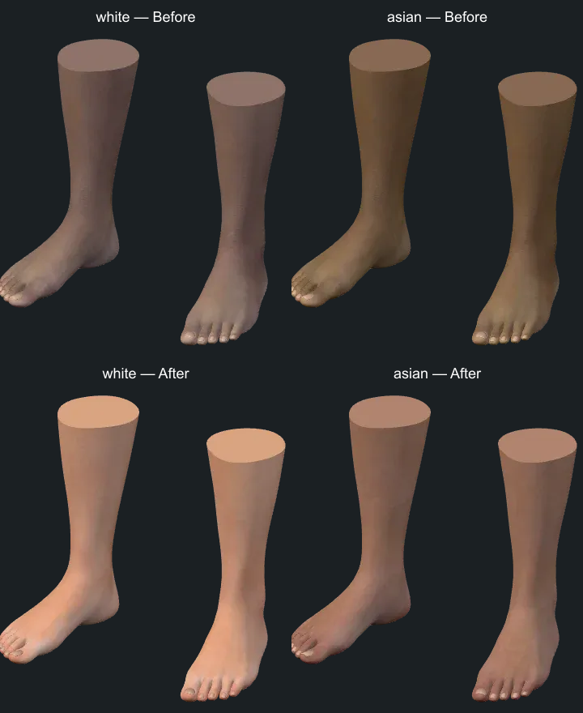

# Female complexion correction

The White and Asian female presets looked like gray or yellow versions of the
tan preset. The cause was in the material pipeline: every female preset used
Laura's `Feminine_04` leg texture, multiplied by a ratio between two UI swatches
in linear RGB. Those swatches were not measurements of the texture's albedo.
Multiplication changed the overall color but retained the same dark regional
pigmentation, the same contrast around joints, and the same surface maps.

## References and comparison

- [Donner et al., SIGGRAPH Asia 2008](https://research.nvidia.com/publication/2008-12_layered-heterogeneous-reflectance-model-acquiring-and-rendering-human-skin)
  models skin with spatially varying absorption and scattering. Its measured
  patches and pigment maps show why local color variation matters; changing
  one global RGB value cannot describe all of it.
- [Aliaga, Hery and Xia, 2022](https://arxiv.org/abs/2201.10695) describes editing
  captured albedo through biophysical skin properties. This informed the
  decision to replace the source complexion instead of treating a UI swatch
  as a skin-conversion model. This app does not implement that spectral model.
- [FOREMOS foot photograph](https://foremos.jp/pages/unfit-ladies-small-shoes)
  shows light skin with gentle warm/pink transitions around the heel and toes,
  fine ankle creases, and subtle variation across the instep. The old yellow
  cast and muddy ankle contrast were visibly unlike this reference.
- [Tap Nails close-up photograph](https://www.tapnails.com/products/russian-pedicure)
  shows pinker toe joints and nail folds, beige highlights and fine texture.
  It helped assess regional color and surface detail at close range.
- The four locally installed **Genesis 9 Feminine** leg texture sets were
  compared directly. The [official Starter Essentials listing](https://www.daz3d.com/genesis-9-starter-essentials)
  documents the four separate feminine skin presets. `Feminine_02` provides
  the lighter peach complexion used here for White; `Feminine_01` provides the
  separate neutral complexion used for Asian. These are appearance presets,
  not measurements or definitions of ethnic groups.

The photographs were viewed as qualitative references; their lighting/exposure
is not calibrated, and they were not copied into the app. Before/after renders
use the same geometry, camera, illumination, exposure and tone mapping.

## Implementation

White and Asian female feet now load **independent color, normal and roughness
maps** from those two installed texture sets. Their material color is exactly
white (no tint multiplier). Local color variation and surface response come
from the maps. Both feet and shins share the selected set, while each pair owns
its material; changing one pair cannot recolor another. The original toenail
material, geometry, skinning and opacity remain intact.

The maps use the existing female foot UV crop. Its exact padded bounds were
recomputed through `build_feet.py` from the Laura mesh before export and are
recorded in `tools/assets/foot-skin-sources.json`. A hash of the shipped UVs
guards against future mesh changes silently invalidating the crop. The build
script copies and crops the source maps without recoloring, resizes them to
2048 px for color / 512 px for detail, and encodes WebP. External color maps
use sRGB; normal and roughness maps use linear data, with glTF's UV orientation.

Run `npm run assets:foot-skins`, then `npm run assets:previews -- --feet-only`
with the dev server running. Source Daz files remain local. Downloads total
228,656 bytes across both optional sets, and the cached decoded maps add about
24.1 MiB. The combined model/complexion texture estimate is 757.2 MiB, within
the existing 768 MiB budget. Maps load on selection and are shared by repeated
pairs; switching tones releases only the per-pair material copy.

## Validation and limits

Material tests require the independent maps for these two presets, verify
orientation and color space, preserve neighboring instances and shared maps,
and confirm no color multiplier is applied. A best-fit per-channel affine
transformation of the old tan map still leaves approximately 6/255 RMS error
against either new texture; the regression check rejects returning to a global
brightness/contrast adjustment. That numerical check detects the old failure
mode; visual inspection remains necessary to judge realism.

The browser checks cover selection, reloads, sharing, both tone lineups and
individual close-up renders. The renderer is still glTF PBR and does not
simulate Iray's full subsurface scattering. These are better source materials,
not a claim of a measured spectral skin shader.

