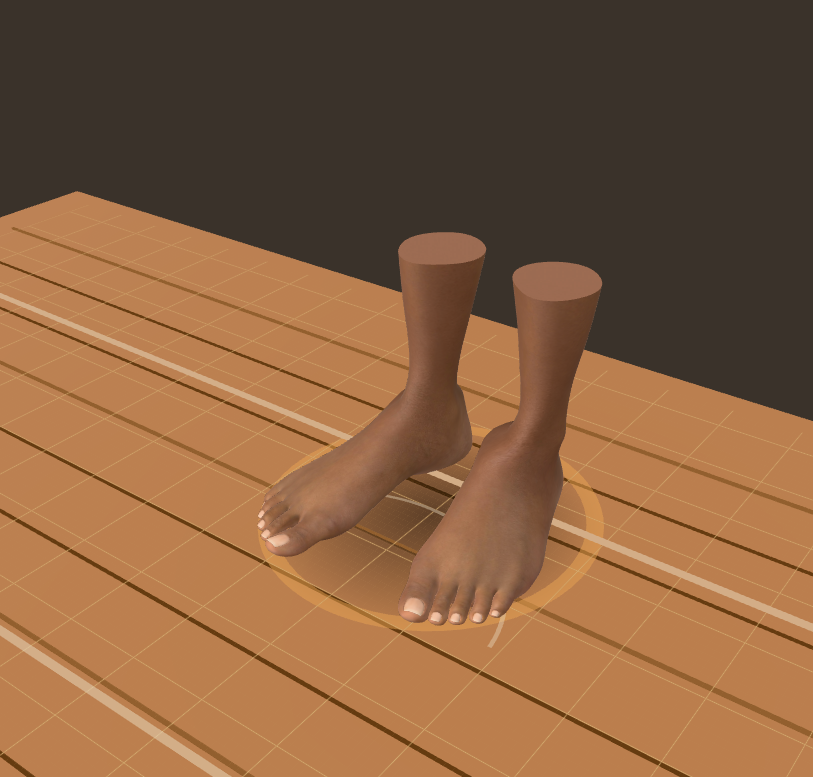
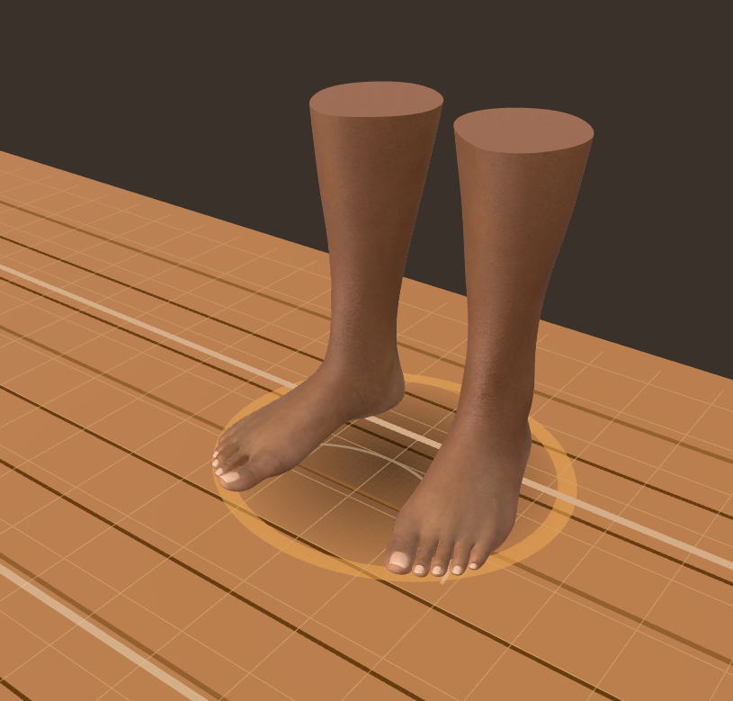
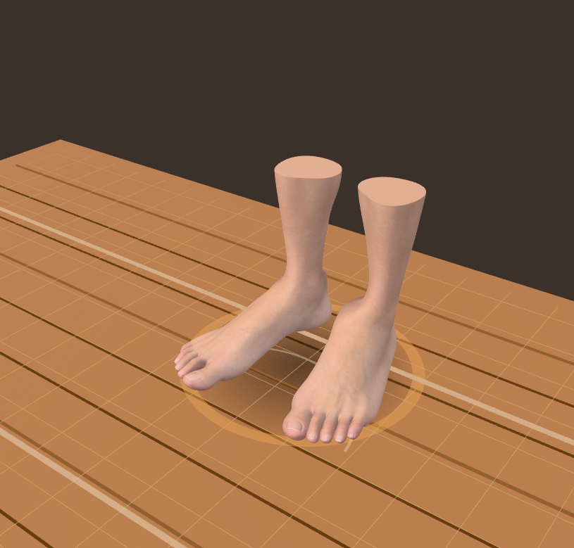
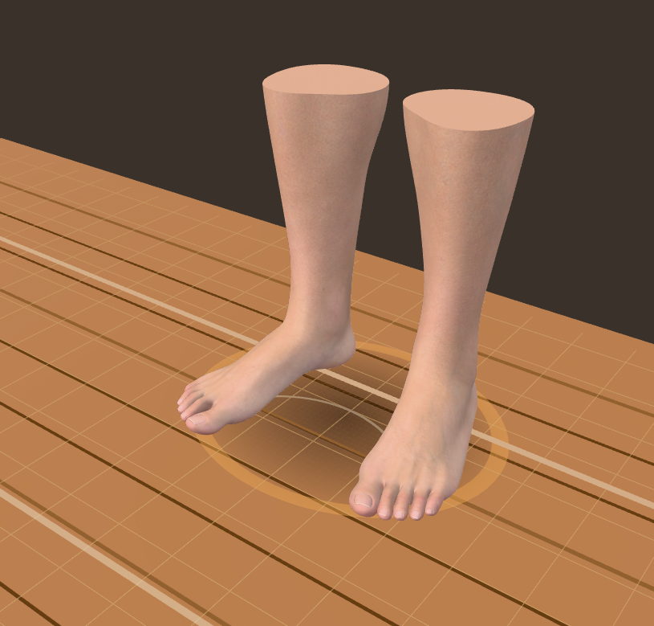

# Phase 6 resource budget

Measured 2026-10-17 on the shipped Genesis 9 assets. Reproduce with:

```sh
npm run build
BUDGET_REPORT=.audit/performance.json npm run verify:budgets
```

The check also runs in the Pages build. `.audit/performance.json` records the exact per-file counts and production chunk sizes. Units below use decimal MB/kB for downloads and binary MiB for estimated texture memory.

## Changes and measurements

| Resource | Phase 5b | Phase 6 |
| --- | ---: | ---: |
| Eight GLB downloads, total | 37.56 MB | 29.75 MB |
| All eight assets' decoded textures, including mipmaps | about 1,082 MiB | 733 MiB |
| Six people's decoded textures | about 1,007 MiB | 658 MiB |
| Per-person GLB | 4.8–6.4 MB | 3.7–4.7 MB |
| Per-person decoded textures | 138–205 MiB | 92–130 MiB |
| JavaScript, total | 1.25 MB / 343 kB gzip | 1.25 MB / 344 kB gzip |
| Largest JavaScript chunk | 1.25 MB | 727 kB |
| WASM | 84,986 bytes | 84,986 bytes |

Normal and metallic/roughness textures are capped at 512 px with aspect ratio preserved. Color/alpha textures retain their original bytes, including the larger face maps. Comparing the previous and rebuilt GLBs confirms that every geometry attribute and color texture is byte-identical. Triangles, materials, UVs, skin weights and landmarks are unchanged. The asset pipeline can repeat this optimization from cached raw Blender exports with `npm run assets:people -- --optimize-only`; it also regenerates rigs and updates manifest byte sizes.

Three.js and React now live in separate cacheable chunks. This does not materially reduce the first download; it avoids replacing the engine when app code changes. Vite's generic 500 kB warning is replaced by a 750 kB threshold, backed by both per-chunk and total JavaScript assertions below.

## Enforced limits

| Metric | Limit |
| --- | ---: |
| Human GLB / feet-pair GLB | 6 MB / 2.5 MB |
| Rig JSON | 1 MB each |
| Triangles per human / feet pair | 230,000 / 43,000 |
| Model draw calls per human / feet pair | 35 / 4 |
| Texture estimate per human / feet pair | 140 MiB / 40 MiB |
| Texture estimate, all eight assets cached | 768 MiB |
| JavaScript chunk / total / total gzip | 750 kB / 1,300 kB / 360 kB |
| WASM / gzip | 90 kB / 35 kB |

The worst ten-person lineup has **2,216,480 model triangles**, and the maximum model draw-call count is **340** (these maxima come from different people). Ten feet pairs have at most **412,880 triangles** and **40 model draw calls**. Stage geometry and extra render passes are outside these counts.

## Method and limits

`verify:budgets` decodes the actual shipped GLBs using glTF-Transform, counts indexed triangles and primitives, reads embedded image dimensions, and sums RGBA8 memory across every mip level. WebP reduces network size; it does not provide GPU texture compression. Repeated placements share geometry and textures, and the asset cache can retain models across both modes. Geometry buffers, per-placement skeletons, WASM/JavaScript memory, CPU image copies, render targets, environment maps and driver overhead are excluded, so 733 MiB is **not total application memory**.

The old README's estimate of 40 MB per person described the earlier asset pack and was inaccurate for Genesis 9. The corrected figures still make a fully populated catalog substantial for mobile hardware. KTX2 textures, level-of-detail meshes and cache eviction are future options; these changes do not claim a mobile frame-rate target.

Automated Chrome checks use software WebGL. Production captures cover all six people at authored height and 10 ft, both US 20 feet, US women's 4 and EU men's 58. Kernel checks retain 0.1 mm tolerance, with a measured worst foot-grid error of 0.045 mm. Real-GPU frame-time profiling remains open.

## US 20 visual check

| | Before | After |
| --- | --- | --- |
| Female |  |  |
| Male |  |  |

Each pair uses the same shoe size and selection camera before and after. The table is wider in the updated version; the centimeter grid remains at the same physical scale.

## Dark workspace follow-up

The UI revamp keeps the same GLBs, geometry and model texture budget. Eight WebP previews total 79,256 bytes; each is below 30 kB, and the total is capped at 150 kB by `verify:budgets`. These previews are lazy-loaded and replace hover/focus-triggered GLB preloads in the model picker. The interface uses system fonts, eliminating external font requests. Current JavaScript is about 1.25 MB / 346 kB gzip; the exact build is recorded in `.audit/performance.json`.

## Per-pair skin tones

Four selectable tones reuse the same geometry, color/normal/roughness textures and draw calls. Each placement owns only a cloned skin material, shared by its two feet; changing the tone releases the previous clone without disposing shared texture maps. Six additional WebP previews bring all fourteen previews to **122,952 bytes**, within the existing 150 kB budget. The budget check now includes every color variant. JavaScript totals about 1.26 MB / 346 kB gzip.

The subsequent female-complexion correction replaces the White and Asian material tints with two independent map sets. The optional maps total **228,656 bytes** downloaded and **24.1 MiB** decoded with mipmaps. They load on demand and stay shared across matching pairs. The aggregate texture estimate is **757.2 MiB**, still under 768 MiB; `verify:budgets` includes every map and enforces a 300 kB combined download limit. Updated previews total **124,460 bytes**. GLBs, geometry and draw-call counts are unchanged.
