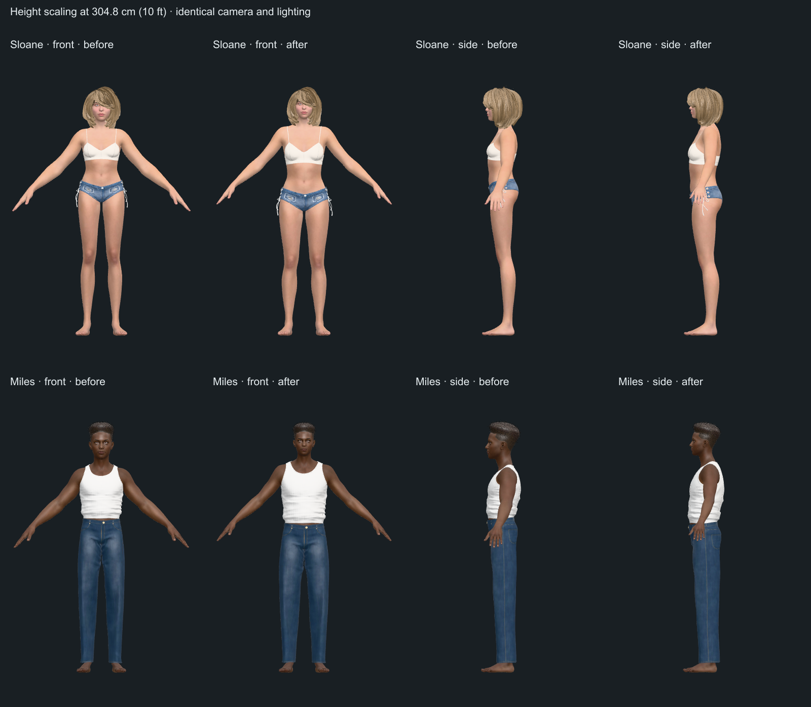

# Balanced stature deformation

2026-10-17 · Implements the correction identified in [the panel review](STATURE_PANEL_REVIEW.md).

Increasing height now grows the head moderately, extends arms along their own anatomical axes, and sizes arm thickness and hands independently. All six people have rebuilt rigs and skin weights. Their authored geometry, height, pose and character identity remain the reference.

## Growth policy

`statureTargets` preserves authored measurements. Inside the observed ANSUR II adult stature ranges (female 1409–1829 mm; male 1491–1993 mm), leg, arm-length, shoulder-breadth, hip-breadth and foot-length targets use the existing fitted exponents. Arm thickness and neck width follow shoulder breadth to preserve the character's build. They are not estimates from an arm-circumference regression.

Whole-head dimensions use a .67 exponent, cervicale-to-tragion spacing uses .8, and hands use .72. These are visual policies selected for this application, not survey-derived biological laws. Ear height is reconstructed downward from the requested crown height and head growth; neck and shoulder heights follow from their authored local gaps. This avoids making head width depend accidentally on where the shoulder sits.

Outside the observed range, relative shape changes taper smoothly. With `q` equal to log height inside the range and smoothly saturated outside it, each growth factor is `(target / reference) × exp((exponent − 1) × (q(target) − q(reference)))`. The saturation span is `log(1.25)`. Dimensions continue growing, values and slopes remain continuous, and relative proportions cannot diverge indefinitely. The 90 cm–10 ft range is an artistic continuation of adult characters, not a child-growth or clinical giant-height model.

## Rig and renderer

The people now use 17 bones: upper arm, forearm and hand are separate on each side. Anatomical Y follows shoulder→elbow or elbow→wrist; transverse X/Z control thickness. Arm length is measured along the joint path. Head, neck, arm and hand widths are measured from the actual surface. Shoulder landmarks belong to the chest; upper-arm skin blends in below the shoulder, and chest weights extend down the upper torso. This removes the previous feedback where growing an arm widened the measured shoulder and forced the chest narrower.

The kernel applies `B × diag(scale) × Bᵀ` for each anatomical basis. Children keep their own dimensions while their joint positions follow their parents. Complete local affine matrices preserve the compensation between differently oriented segments; decomposing them into position/rotation/scale would lose shear. Three.js consumes those same matrices. Human skin normals use the inverse transpose of the blended transform, so independent length and girth changes retain appropriate lighting. Existing feet rigs use the identity basis and retain their measurements and behavior.

Human solves use a 0.005 mm stopping tolerance. The tighter tolerance prevents nearby neck/shoulder landmarks from amplifying small residual errors into differing torso scales when returning to a previous height.

## Measured result

The following are changes in dimension ratios at **3048 mm**, relative to each person's authored ratio. A value of 0% means that dimension keeps its original relation to shoulder breadth. Arm thickness here is transverse linear growth in a pure upper-arm region, not circumference measured over a blended shoulder.

| Character | Head / shoulder before | Head / shoulder after | Arm thickness / shoulder before | Arm thickness / shoulder after |
| --- | ---: | ---: | ---: | ---: |
| Ari | +17.72% | −1.41% | +25.65% | −0.10% |
| Mika | +17.90% | −1.43% | +25.91% | −0.08% |
| Sloane | +16.77% | −1.27% | +24.23% | −0.04% |
| Luca | +24.03% | +1.51% | +28.53% | −0.03% |
| Miles | +23.49% | +1.46% | +27.89% | −0.03% |
| Owen | +23.86% | +1.49% | +28.33% | −0.02% |



The cameras, framing and lighting match the baseline. Equal displayed stature makes proportion changes visible independently of zoom.

## Verification

- `verify:kernel`: 11 Rust tests, 378 foot solves, 62 synthetic body-column solves and 120 shipped-person height-grid solves. Worst person-grid error is 0.0049 mm; foot-grid error remains 0.0445 mm.
- Actual Three.js skinning is checked against kernel measurements for all six people, including both arms' transverse dimensions, head attachments, hand proportions, floor contact and repeated up/down height edits.
- The implementation panel independently checked 72 randomized poses on 24 rigs with noncommuting bases, mixed inheritance and blended weights: 2,592 coordinate comparisons, maximum discrepancy 0.000229 mm.
- The anthropometry panel independently swept targets in 1 mm increments from 900–3048 mm for all six people: authored identity, positive and increasing segment gaps, and continuous boundary slopes. No substantive implementation or policy findings remained.
- Ninety nonblank diagnostic captures cover six people × five heights (900, authored, 2000, 2400, 3048 mm) × front, side and three-quarter views. Visual inspection covered all six front silhouettes across the range and all six side/three-quarter silhouettes at 10 ft. No new joint disconnections or gross clothing tears were seen; this is not a per-triangle intersection proof.
- `verify:domain`, `verify:models`, lint, TypeScript/Vite build, resource budgets and desktop/mobile UI workflows pass. Production rendering checks also pass for all-six authored and 10 ft lineups, shoe-size extremes and all foot tones.
- A local Node/WASM warm-edit timing sample (40 heights per person) measured medians of 3.12–3.47 ms and per-model 95th percentiles of 3.34–3.74 ms. This is solver timing, not real-device rendering performance.

The UI verification captures the canvas through the browser compositor and checks pixel contrast. This avoids the extra synchronous `readPixels` call that stalled the ten-person software-WebGL scene. Diagnostic capture also rejects blank images. Verification used a stable Vite server without file watching to avoid build-triggered page reloads during long browser runs.

## Reproduction

```sh
npm run build:kernel
node --experimental-strip-types .audit/stature-panel-rig.mjs
# With a development server running (APP_URL may override port 43123):
node .audit/capture-stature-fix.mjs
npm run verify:kernel
```

The numeric script writes `.audit/stature-fixed-rig.json`; the original `.audit/stature-panel-rig.json` is retained as baseline evidence. Capture metadata is in `.audit/stature-fixed-captures.json`, individual frames are written to `/tmp/3d-compare-stature-fixed`, and the before/after sheet is saved above. The baseline report and its original reproduction scripts can be reproduced from commit `d2518ee`.
