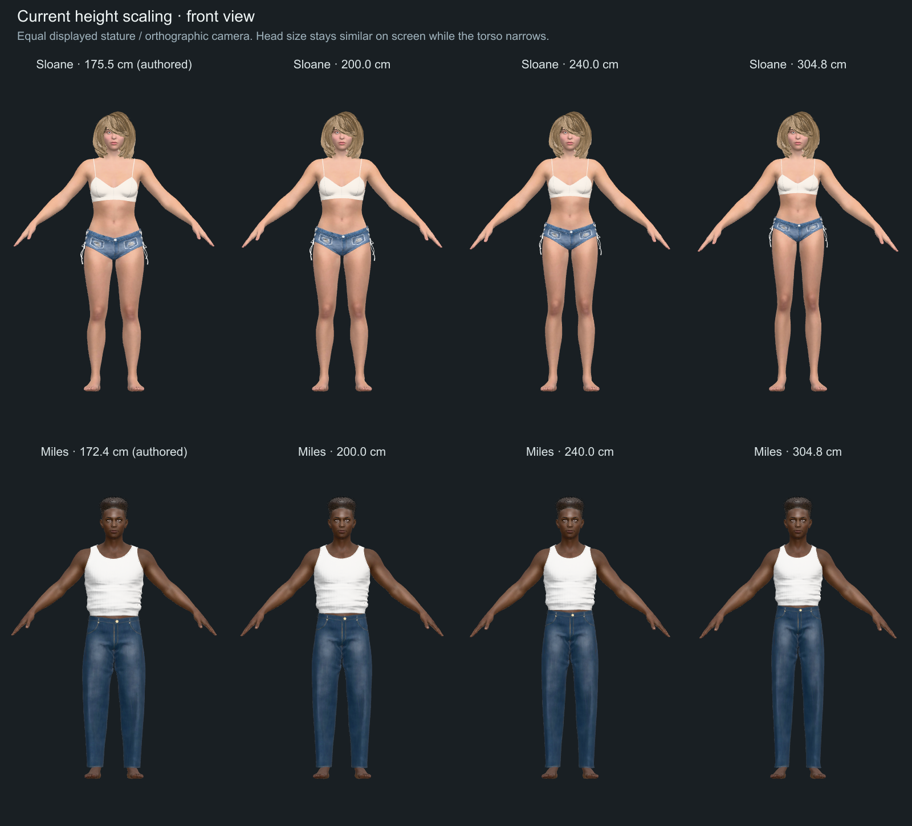
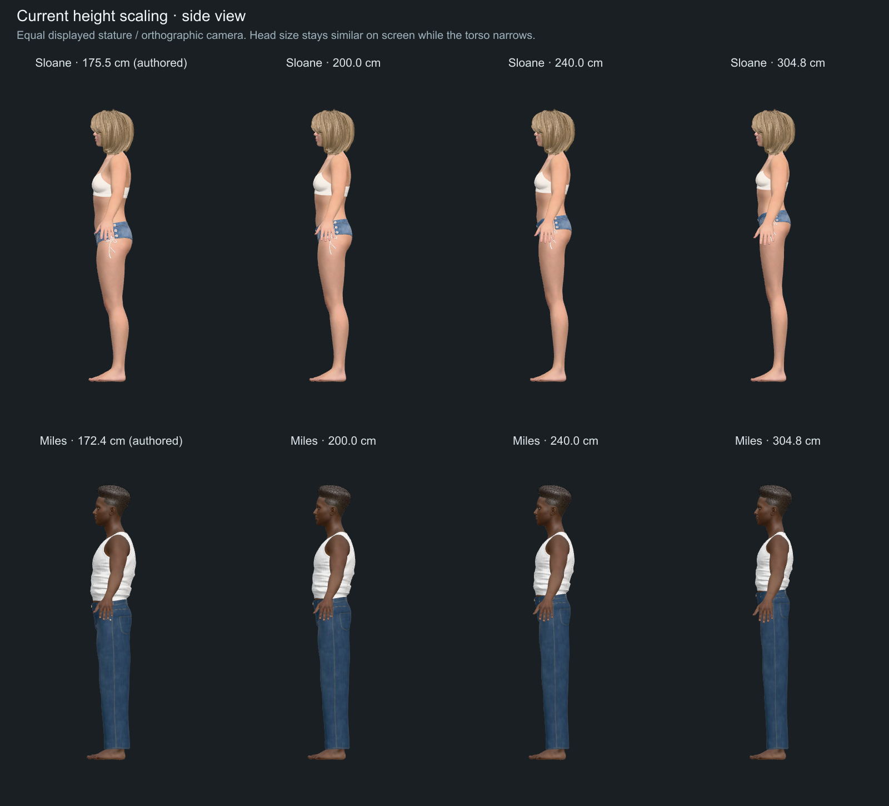

# Human stature deformation: panel assessment

2026-10-17 · Reviewed production revision `4d0ec87` · Historical baseline assessment. The subsequent correction is documented in [STATURE_IMPLEMENTATION.md](STATURE_IMPLEMENTATION.md).

## Finding

The reported oversized heads and thick arms have reproducible causes in the current growth policy. The solver accurately implements incompatible dimensional rules: head and neck grow directly with stature; arms grow uniformly using a length curve; shoulder and torso breadth grow more slowly. The resulting figures have increasingly dominant heads, necks, arms and hands against narrower, relatively shorter torsos.

This is primarily a shape-policy and rig-capability problem. The audit found no evidence of an extra whole-character scale, incorrect units, accidental parent-scale compounding or a camera-only illusion.

Three subagents independently assessed implementation, anthropometry and validation. Their findings were cross-checked against production WASM solves and new diagnostic renders. The validation panel independently recomputed the implementation panel's ratios; a transcribed arm-scale range was corrected before this synthesis. All three agree on the causes and on separating length, girth and placement. They do **not** establish a uniquely correct growth curve at fictional statures.

| Panel | Evidence examined | Assessment |
|---|---|---|
| Rig and solver | Rig generation, shipped sidecars, Rust transforms, Three.js skinning, 30 solves | Enlargement is explicitly requested by the controls; inheritance cancellation works. |
| Anthropometry | Digest-checked ANSUR II CSVs, independent regressions, primary documentation | Arm length does not justify equal girth growth; head-above-ear is not whole-head size; extreme-height extrapolation needs a deliberate visual policy. |
| Visual validation | Existing tests and renders, landmark weights, independent ratio calculations | Tests enforce the problematic head policy and lack independent anatomical outcome checks. |

## What the application currently does

1. `src/scene/height/figures.tsx:39` measures the authored character's landmarks through its rig. Values are converted from meters to millimeters.
2. `src/domain/stature.ts:58` predicts adult survey dimensions with `coefficient × height^exponent`.
3. `statureTargets` at line 81 scales each authored landmark by the predicted change between authored and requested height. This preserves authored identity at the reference height.
4. Lines 88–92 override shoulder, neck and ear heights with a direct stature ratio. Exact crown height is also requested. This override was introduced by commit `11a9366` to address the earlier small-head complaint.
5. `scripts/person-rig.mjs:48` maps these targets to 11 controls over a 13-bone simplified rig. Head, neck and both whole arms use uniform XYZ scaling.
6. The WASM solver finds controls satisfying the landmark targets. `src/scene/rigged.ts:121` applies its local scales to Three.js bones, deforming body, eyes, hair and clothing together.

The application is therefore doing more than stretching the whole model, but several anatomical dimensions still share a single control.

## Quantified result

The audit executes the actual `statureTargets`, shipped rig files and WASM solver for every character at 900 mm, authored height, 2000 mm, 2400 mm and 3048 mm: 30 solves. Reference heights come from measured geometry, not rounded catalog labels. Maximum target error in this audit is below 0.012 mm.

The table reports the change in a ratio relative to the same authored character. For example, +24% means head-width/shoulder-breadth is 1.24 times its original value; it does not mean the head is 24% of the body. Arm thickness uses the exact uniform scale in regions wholly assigned to an arm bone; blended shoulder regions are more complicated. These are deformation measurements, not a medical normality threshold.

| Requested height | Head width / shoulder breadth increase, all six | Arm thickness / shoulder breadth increase, all six |
|---|---:|---:|
| 200 cm | 3.7–6.1% | 5.3–7.2% |
| 240 cm | 9.2–13.5% | 13.1–15.9% |
| 304.8 cm / 10 ft | 16.8–24.0% | 24.2–28.5% |

At 10 ft, absolute dimensions change as follows:

| Character | Authored stature | Head linear scale | Arm linear/girth scale | Shoulder breadth scale | Head/shoulder change | Arm/shoulder change |
|---|---:|---:|---:|---:|---:|---:|
| Ari | 170.5 cm | 1.787× | 1.908× | 1.518× | +17.7% | +25.6% |
| Mika | 169.6 cm | 1.797× | 1.919× | 1.524× | +17.9% | +25.9% |
| Sloane | 175.5 cm | 1.737× | 1.848× | 1.487× | +16.8% | +24.2% |
| Luca | 170.4 cm | 1.788× | 1.853× | 1.442× | +24.0% | +28.5% |
| Miles | 172.4 cm | 1.768× | 1.831× | 1.431× | +23.5% | +27.9% |
| Owen | 171.0 cm | 1.782× | 1.846× | 1.439× | +23.9% | +28.3% |

### Head and neck

The head does **not** grow relative to total stature: that ratio is deliberately held constant. It grows too quickly relative to shoulder and torso breadth. Let `r` be requested/authored stature. Head size is approximately `r`, whereas shoulder breadth is `r^0.7191` for female models and `r^0.6296` for male models. Head/shoulder therefore grows approximately as `r^0.2809` or `r^0.3704`.

This explains the apparent contradiction between the previous small-head correction and the current complaint. The earlier correction fixed one comparison—head versus total height—without preserving head versus body breadth. It also changed neck scaling to XYZ and removed neck width from the shoulder-breadth control. Neck width consequently grows with stature too.

`stature − ear` measures only the part of the head above the ear. The rig has no chin-to-crown, full head breadth, or neck-girth measure. Lower-face and neck transitions cannot be validated from the existing upper landmarks alone.

### Arms and hands

`scripts/person-rig.mjs:59` connects arm length to X, Y and Z on both arm bones. The length exponents are 1.1092 for female models and 1.0598 for male models. Increasing height thus lengthens and thickens each arm together. At 10 ft, pure-arm cross-sectional area is 3.35–3.68 times its authored area, a geometric consequence of multiplying both transverse dimensions. This is not an estimate of body mass.

`tools/assets/build_people.py:369` and line 467 collapse upper arm, forearm, hand and fingers into one region per side. There are no separate elbow, wrist, hand or girth controls. Hands therefore receive the arm-length scale too. The arm measure is shoulder-to-wrist **vertical drop in the A-pose**, rather than the anatomical upper-arm-plus-forearm path used by the survey. Relative drop is a serviceable proxy under the present uniform scaling; it must be reconsidered when the deformation changes.

### Shoulder and torso coupling

All six shipped shoulder landmarks have about 59.2% arm, 20.4% pelvis and 20.4% chest influence. Growing the arms moves the surface point used to measure shoulder breadth. The solver compensates with a smaller chest transverse scale: at 10 ft, Ari's measured shoulder breadth grows 1.518× but the chest bone X/Z scale is 1.455×; Luca's corresponding factors are 1.442× and 1.382×.

Those chest-bone factors are **not measured thorax widths**. `build_people.py:468` assigns most core geometry below shoulder height to the pelvis; the chest bone primarily controls the upper transition. Hip breadth also controls thigh and shin X/Z (`person-rig.mjs:58`). The rig consequently lacks independent chest, waist and limb-girth dimensions despite its anatomical bone names.

There is a second proportion change: leg landmarks keep their superlinear fits while shoulder height is forced to grow linearly. For Ari, crotch height increases from 47.7% to 54.5% of stature, and shoulder-to-crotch span decreases from 34.9% to 28.1%. For Miles these change from 46.2% to 52.0% and 36.1% to 30.3%. These are coherent with the implemented equations, but they compound the increasingly dominant upper appendages and should be assessed with the head/arm fix.

At the 90 cm lower limit, the mismatch reverses: head/shoulder falls 16.3–21.4%, and arm/shoulder falls 22.1–24.5%. A correction must cover shrinking as well as enlarging.

## Matched visual evidence

New images use the production assets, target function, solver and `rigNode`/`applyPose`, with the application's studio lighting and tone mapping. They use an orthographic camera and equal displayed stature to isolate changes in shape. They are diagnostic renders, not screenshots of a modified application. Sloane and Miles provide visible arms; numerical checks cover all six characters.

At equal displayed height, the heads stay almost identical in size while torso width and length diminish; arms and hands become more prominent. The side view makes the torso-depth versus arm-thickness imbalance particularly visible. No absolute pixel measurement from these images is used as an anatomical claim.





## What the reference data can support

ANSUR II is a cross-sectional survey of different Army personnel for anthropometric design, not longitudinal observations of an individual growing. The public release contains 1,986 female and 4,082 male records, as documented by the [U.S. Army's release](https://www.army.mil/article/188601/for_good_measure_natick_releases_raw_data_from_army_wide_anthropometric_survey). The [methods report catalog](https://ntrl.ntis.gov/NTRL/dashboard/searchResults/titleDetail/ADA611869.xhtml) describes the measurements and survey methodology. [University of Michigan anthropometry guidance](https://mreed.umtri.umich.edu/mreed/downloads.html) cautions that a military sample need not represent a particular target population.

Independent calculations on the repository's SHA-256-checked public CSVs give stature ranges of 140.9–182.9 cm for females and 149.1–199.3 cm for males. Both 90 cm and 304.8 cm are substantial extrapolations. The supported UI range is not a validated anatomical range; a shrunken adult asset is not a child model.

Our log-log ordinary least-squares refits reproduce the shipped arm/shoulder exponents and provide this comparison. These calculations are from the pinned data, not quoted results from the linked publications. R² is calculated in log space and measures association in that fit, not causality or individual predictability.

| Survey measurement | Female exponent | Male exponent | Female R² | Male R² |
|---|---:|---:|---:|---:|
| Upper-arm + forearm length | 1.1092 | 1.0598 | .6576 | .6687 |
| Flexed biceps circumference | .6346 | .4707 | .0631 | .0360 |
| Flexed forearm circumference | .6354 | .5481 | .1290 | .0912 |
| Shoulder breadth | .7191 | .6296 | .3176 | .2834 |
| Tragion to crown | .2896 | .2395 | .0482 | .0392 |
| Head breadth | .1411 | .0692 | .0251 | .0057 |

Log height explains roughly two thirds of the observed log arm-length variation, but only 3.6–6.3% of log flexed biceps variation. A length curve is therefore a poor basis for arm thickness. Flexed-arm girths also must not be imposed directly on an unflexed A-pose. Body build should remain distinct from limb length.

Neither the raw head-above-ear exponent nor the current exponent of 1 supplies a defensible whole-head rule at 10 ft. Simply restoring the old curve risks repeating the earlier visual failure. Independently scaling floor-relative landmarks is another approximation: the resulting difference between two heights need not follow the intended local segment curve. Prefer explicit segment dimensions and assemble their positions consistently.

## Why the tests pass

- `scripts/verify-kernel.mjs:413` requires head and attached geometry to grow by the full stature ratio in every axis; lines 415–417 impose the same condition on neck and head world scales. The current defect is partly encoded as success.
- `scripts/verify-domain.mjs:338` preserves upper-landmark offsets as a constant fraction of stature. The decreasing-relative-head check at line 327 tests `averageLandmarks`, not the `statureTargets` actually displayed.
- `scripts/verify-rendering.mjs` checks visible pixels, label size and browser errors. Human captures use authored height and 10 ft, with no approved silhouette comparison or arm/head proportion threshold.
- Kernel-to-Three.js agreement and exact-height checks are valuable, but agreement between two implementations of the same policy does not validate that policy.

Baseline domain, model, kernel, budget and rendering verification, lint and production build pass on the reviewed code. Rendering verification completed all ten scenarios, including authored-height and 10-foot lineups. This is consistent with the diagnosis, not contrary evidence.

The broader UI script was attempted but stalled after its desktop height screenshot and was terminated after approximately five minutes of software-WebGL execution. Its remaining UI assertions are **not** reported as passing. Application code is unchanged by this review; this incomplete check does not weaken the independently reproduced deformation measurements, but it remains a verification limitation.

## Recommended correction, in dependency order

1. **Define one coherent proportion policy.** Preserve each character exactly at authored stature. Decide head/neck, shoulder/torso, upper/lower arm and hand relationships together. Keep height as the user input; a more capable internal model need not add UI complexity. Separate the survey-supported interval from a smooth, bounded artistic extension at extreme heights.
2. **Separate head size from vertical placement.** Start with an identity-preserving whole-head size factor, keeping facial proportions and eye/hair attachment alignment. Place it above an independently controlled neck rather than using total stature to dictate its size. Measure full head extent and neck girth. Head exponents around .6–.7 are possible visual experiments because they approximately track the existing breadth curves; they are not validated biological constants. Compare alternatives before selecting one.
3. **Separate arm length, girth and hands.** Prefer upper-arm, forearm and hand regions with shoulder/elbow/wrist anchors. Lengthen along anatomical limb directions while controlling perpendicular dimensions separately. Preserve taper and authored muscularity. Reassess the vertical-drop proxy and introduce real segment-length/cross-section measurements.
4. **Make shoulder/torso constraints structurally meaningful.** Distinguish skeletal joint placement from surface breadth; a virtual joint center is not interchangeable with an ANSUR acromion measurement. Add torso cross-sections and review the deltoid/axilla blend. Changing only a shoulder anchor without updating surface weights could create new seams or pinching.
5. **Update the deformation contract and tests together.** The current kernel supports only axis-aligned scales with identity rest rotations. Changing arm `xyz` to global `y` is not a valid fix for a diagonal A-pose arm. Oriented length/radial scaling requires a defined limb basis and matching affine transforms/parent compensation in Rust and Three.js. Component-wise division of parent scale is insufficient for arbitrary oriented anisotropy. Test actual transformed vertices and normals, then body/clothing transitions.

Corrective morphs are an alternative or later refinement, but are not ready to use: shipped people have no morphs, and `applyPose` does not apply `pose.morphWeights`. Their export, accessory deformation and GPU application would need implementation and parity tests. The existing Three.js skin-normal path also deserves review if substantial new anisotropy or shear is introduced; this is a prospective risk, not the diagnosed cause of today's size defects.

Do not solve this with a smaller head multiplier alone, a blanket arm-length reduction, or wider shoulders chosen to disguise thick arms. Those changes would leave the dimensional coupling intact.

## Acceptance criteria for the correction

| Area | Required evidence |
|---|---|
| Size and identity | Exact stature within the existing tolerance, grounded soles, authored-pose identity, unchanged facial proportions, eyes/hair/clothing aligned. |
| Proportions | Full head/shoulder, head/stature, neck/head, arm-girth/shoulder and hand/forearm ratios measured from deformed geometry; reviewed bounds independent of the implementation equations. |
| Limb anatomy | Anatomical segment lengths, perpendicular upper-arm/forearm/wrist cross-sections, taper, symmetry, elbow shape and shoulder/axilla continuity. |
| Rig correctness | Kernel/GPU vertex and transform agreement; normal/shading checks under neutral lighting; well-constrained controls. |
| Interaction | Cold/warm solves agree, shrink→grow returns to the same shape, edit order has no effect, slider changes remain smooth across any extrapolation transition. |
| Visual matrix | All six models at 90 cm, a short-adult stature, authored height, 200, 240 and 304.8 cm; front/side/three-quarter views, consistent world scale and height-normalized views, exposed-body diagnostic surfaces plus normal clothing. |

The present review supplies all-six numerical evidence and 16 representative front/side renders. It does not claim a complete clinical anatomy model, final replacement exponents, or a full per-triangle clothing/intersection audit. Those are distinct from identifying the current defects.

## Reproduction

The following reproduces the **baseline** from commit `d2518ee`, with dependencies installed. Current scripts produce the corrected results described in `STATURE_IMPLEMENTATION.md`:

```sh
npm run build:kernel
node --experimental-strip-types .audit/stature-panel-rig.mjs
python3 .audit/stature-anthropometry.py > .audit/stature-anthropometry.json
```

The numeric evidence is in `.audit/stature-panel-rig.json`; the independent statistical memo is `.audit/stature-anthropometry-panel.md`. With the Vite development server at `http://127.0.0.1:43123`:

```sh
node .audit/stature-panel-capture.mjs
```

The capture script writes the two comparison sheets under `.design/renders/` and individual frames under `/tmp/3d-compare-stature-audit/`. It uses the application deformation path without changing application source or assets.
